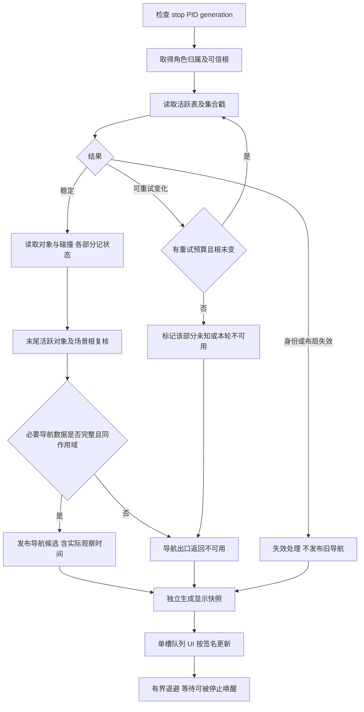

# 场景临时读取失败优化：实施流程与验收方案

日期：2026-10-25。状态：**待审阅的实施方案，尚未实施**。

适用项目：`Yxx0723/auto-Heartopia`。审计分支：`restore/d50087c-20261023`；审计 HEAD：`50d45c42463716f58d0347686774d597590d1b30`。

本文件依据该版本实际源码、现有测试及本地只读采样编写。不是旧 P1/P2 支撑面方案的继续实施，也不假定那些分支中的接口已在当前版本启用。

## 1. 本次交付和授权边界

本次只新增方案文档，不修改 Python、测试、配置或用户路线，不打包、不替换程序、不操作角色。后续必须由用户明确要求修改代码或开始实施，才执行本文开发阶段。对文档的确认不自动授权后续游戏操作或部署。

目标顺序：

1. 减少可恢复的临时读取失败向整轮失败升级。
2. 缩短失败后的恢复路径，避免不必要的读取器重建。
3. 防止个别对象变化清空整张资源地图。
4. 保持场景、对象身份和碰撞校验，失效数据不能用于寻路。
5. 最后讨论显示层的短时保留；它不能代替读取正确性。

用户尚未选择“读取失败后保留多久旧画面”。本文将该策略单独列为待确认项，不把动态对象保留视为已批准行为。

非目标：保证零读取失败、全图常驻实体、完整 NavMesh、改写游戏内存、暂停游戏线程、注入游戏调用、重新设计整个寻路器或改变已保存路线。

## 2. 已确认的现象与证据边界

用户现象：偶尔只剩道路、水域和少量底图，树木、昆虫等图标消失，几秒后自行恢复。

本地只读诊断记录：`work/native-monitor/map-blank-diagnosis-20261025-224313/result.json`。该文件仅为本地运行证据，不随本文上传实际运行数据。

| 观察项 | 本次结果 | 能说明什么 |
| --- | --- | --- |
| 独立只读采样 | 15 次，已结束 | 没有按键、移动或采集操作 |
| 成功样本 | 10 次 | 失败后同进程仍能读到场景 |
| 集合在读取时变化 | 3 次 | 一致性检查确实会拒绝临时变化 |
| 场景引用无效 | 2 次 | 指针范围检查确实拒绝过无效引用 |
| 成功读取耗时 | 1.160～2.781 秒 | 当前完整扫描不能按目标 0.2 秒保证完成 |

这些是一次短时诊断，不是长期失败率统计，也不能证明两个“引用无效”来自同一个字段。记录没有完整阶段与调用栈，无法据此将所有非法引用定性为正常卸载，更不能确定截图当时是哪条错误。

先前约 0.92 秒的读时属于另一批场景采样，不能作为所有场景的固定耗时。60 Hz 是 UI 调度目标，不能使分多次进行的内存读取自动成为原子快照。

## 3. 当前源码调用链

### 3.1 生产、发布与显示

```text
SceneMapWorker.run（后台 scene-map-reader 线程）
  -> poll_once
     -> MemorySceneMap.snapshot
        -> 角色快照与 local_hierarchy
        -> ActiveHierarchies 根与 SceneMetadata.dictionary
        -> 对象分类、层级变换、模型锚点
        -> PhysicGroup / stream / collision / collider 集合
        -> NativeWorldCollisions.snapshot
        -> 场景归属复核
        -> 全图矿物定义、房门、已核实地形边界
        -> refresh_live_objects（再次读取 ActiveHierarchies）
        -> 最新角色快照及场景归属复核
     -> SceneDisplayCache.update
     -> latest_scene + latest_at（导航通道）
     -> Queue(maxsize=1)（显示通道）
CoordinateWindow.tick
  -> take_latest -> self.scene_state
  -> render -> draw_if_changed
     -> MapGeometryIndex.select / RetainedMap 缓存绘制
```

道路、水域来自绘图缓存持有的参考几何，资源、模型和实时碰撞则取自 `scene_state`。因此资源快照变为空时，参考底图仍可绘出，符合截图表现。

### 3.2 导航消费者

```text
CoordinateWindow.navigation_scene(pid)
  -> SceneMapWorker.navigation_snapshot(pid)
PointPlayback -> LocalNavigator 的 scene_provider
  -> LocalNavigator 路径规划、恢复检查
  -> coordinate_player 回放与 special_patrol 巡查等消费者
```

当前 `navigation_snapshot` 检查 PID、停止状态、快照是否存在、`state`、`world_state` 和发布年龄。当前门限 `COORD_NAV_SCENE_MAX_AGE = 6.`。

部分下游只检查 `scene['state'] == 'ready'`。因此以后增加 `partial` 或分层状态时，不能仅修改生产者：必须由导航出口统一拒绝不合格快照，并检查巡查包装器和缓存复用是否绕过这一出口。

### 3.3 错误处理造成的放大

当前 `SceneMapWorker.poll_once` 对所有 `OSError / ValueError` 使用同一分支：关闭读取器，生成空 `objects / colliders`，将错误发布给界面。`SceneDisplayCache.update` 遇到错误、缺少上下文、非法位置或原生碰撞未 ready 时，会清空固定历史。

随后 `run` 对失败使用 `COORD_MONITOR_RETRY_SECONDS = 2.` 退避。下一轮还可能重新初始化读取器并读取完整场景。总恢复时间不止 2 秒。

成功时仍采用 0.2 秒的起始间隔目标，扣除读取成本，并至少让出 0.05 秒。本文不建议把 60 Hz UI 帧预算用于场景读取或失败重试。

## 4. 已有能力必须复用，不能重复实现

| 实现位置 | 当前已有能力 | 本次需要补的部分 |
| --- | --- | --- |
| `utils/drivers/mono_scene.py:SceneMetadata.dictionary` | 读取 `_version/_count/_freeCount/_entries` 前后戳；校验容量、布局、占用数量；批量读 entries | 给“戳变化”提供结构化原因和有限局部重读；保留其他错误的拒绝行为 |
| `SceneMetadata.list_refs` | 列表大小、版本、类型校验 | 如实际调用点需要，再按同样规则局部恢复 |
| `MemorySceneMap.snapshot` 对象循环 | 已跳过部分 `ValueError` 对象 | 记录失败对象的范围与完整度，防止“跳过”被误当作确认消失 |
| `refresh_live_objects` | 结束前复核活跃表、动态对象归属、类别和位置；局部异常跳过对象 | 活跃表读取本身在局部 try 之外，失败仍会抛至整轮；需要限定恢复范围 |
| managed 碰撞循环 | 触发器、禁用、未支持形状过滤；部分单碰撞体异常隔离 | group/stream 的集合遍历有整轮抛错路径；缺失必要碰撞不能伪装完整 |
| `NativeWorldCollisions.snapshot` | 源箱体与池槽归属、启用、原始数据及根校验；临时 cache 成功后提交 | 不取消复核；将流式变化与布局失配区分，失败不能提交半成品 |
| `SceneDisplayCache` | 仅固定且有身份的对象历史；容量、TTL、世界作用域 | 区分“不完整观察”和“完整观察确认缺失”；短时显示策略另审 |
| `MapGeometryIndex.select` | 以场景和容器身份建立绘图索引 | 新快照应新建或写时复制，避免原地改列表而未触发索引更新 |
| `SceneMapWorker` | 单线程读场景、generation 校验、有界队列、导航和显示分离 | 精细恢复、分层状态、观测时间、失败分类；保留生命周期保护 |

## 5. 基础规则：什么可以重试，什么必须拒绝

### 5.1 错误分类设计（拟新增，不是当前接口）

建议引入内部异常或诊断类型，兼容已有 `ValueError` 捕获，但生产者与 worker 要对新类型明确分流。可采用 `SceneReadIssue(ValueError)` 携带下列字段；最终命名以实施审查为准。

| 字段 | 用途 |
| --- | --- |
| `kind` | mutation、entity_gone、scope_changed、layout_invalid、io_error、unknown |
| `scope` | root、registry、object、managed_collision、native_collision、optional_definition |
| `stage` | 当前调用阶段，区分首次活跃表与末尾复核 |
| `retryable` | 仅由已识别的失败路径赋值，不能由消息猜测 |
| `owner_recheck` | 是否必须从可信父级重新取得目标引用 |
| `epoch / generation` | 本进程本次采样作用域，不能当作永久实体 ID |
| `attempt / elapsed` | 本轮重试次数及耗时，便于预算与观测 |

错误消息用于显示和诊断，不能成为长期控制逻辑。旧的未知 `ValueError` 不自动升级为可重试错误。类型、域、布局、数量上限和非法数值检查继续有效。

### 5.2 分类及处理表

| 情况 | 有限重读 | 是否保留读取器 | 导航 | 显示 |
| --- | --- | --- | --- | --- |
| 已识别的集合前后戳变化 | 同一集合从可信父级重新定位，允许 | 根与域仍有效时保留 | 必要部分未恢复则不可用 | 不影响其他已确认有效层 |
| 确认对象已退出活跃表 | 不沿旧指针重试；记录本对象缺失 | 保留 | 视其是否为必要碰撞数据判定 | 该对象可移除 |
| 对象引用无效但原因未明 | 先核对父级、身份和根；不是无条件重试 | 由复核结果决定 | 不得把缺失碰撞当空地 | 该对象为未知，不宣称已消失 |
| 原生 grid/pool 正在变化 | 最小可完整验证的碰撞部分重读 | 同根且元数据有效时保留可信部分 | 未通过全部必要 guard 则不可用 | 几何不能半份冒充完整 |
| 根、域、角色归属或 PID 确认改变 | 本轮立即终止 | 对应读取器或子缓存失效 | 立即无效 | 清除旧作用域数据 |
| 类型、布局、容量或数值不符 | 不自动循环重读 | 作失配诊断；按现有保护重建或退避 | 不可用 | 不发布可疑对象 |
| 进程退出、权限失效等 IO 错误 | 先区别退出、拒绝访问和单地址不可读 | 真正失效才关闭；未知错误保守处理 | 不可用 | 不伪造新鲜数据 |

`OSError` 不能一律归为“对象正常卸载”。`场景引用无效` 当前只表示值不在合法引用范围，并未证明该对象已经被游戏销毁。

## 6. 详细执行流程

### 6.1 一轮采样的总流程



### 6.2 集合有限重读

1. 先检查停止、generation 与重试总预算。
2. 从可信 owner/root 的字段取得集合引用，不盲目复用失败地址。
3. 检查集合实际类型、运行时布局、数量、容量和单次字节上限。
4. 取得前戳，批量读 entries，再取得后戳并核对占用数量。
5. 成功只表明本次容器观察通过现有检查；不保证所有对象字段在同一瞬间一致，也不证明数据是全图完整资源。
6. 如果是已识别的戳变化，丢弃本次结果，检查可信根仍相同后，再开始一次有限重读。
7. 若类型、数量、布局或根失效，不进入“变化重试”。
8. 预算耗尽后返回结构化不完整状态，不能用空列表冒充完整的零对象场景。

必须保留 `_count / _freeCount / _entries` 检查。现有测试已覆盖删除不增加 version 的情形；不能把检查简化成只比较 `_version`。也不能只比较两个列表长度。即使戳相同，内部字段变化、地址复用或 ABA 情形仍可能存在，关键对象仍需归属复核。

### 6.3 单对象读取与消失确认

1. 以本轮活跃表中的 hierarchy 为入口，读取 owner 与实际类型。
2. 核对归属后读取类别、坐标、必要资源状态；记录观察时间和结果。
3. 局部失败后，只允许从可信入口重新定位并复核同一身份，禁止继续追踪旧的失效地址。
4. 如果第二次稳定活跃表确认对象不在，标记 `confirmed_absent`。
5. 如果对象仍在，但字段不能读取，标记 `unknown`；不能称其已捕获、已采集或已消失。
6. 如果地址被复用、owner 或类别改变，丢弃旧对象结果，不能将旧资源状态附到新身份上。
7. 末尾动态复核保留；不能为了降低错误数量取消它。

无需对当前已能跳过的每个异常都新增重试。优先覆盖有证据的变化路径，避免对象数乘以重试次数造成成本爆炸。

### 6.4 碰撞部分的处理

managed group/stream 与原生碰撞应各自记录有效性。原生读取中，当前结果和 `geometry_cache` 在末尾校验后提交的方式继续保留。

- 正常忽略触发器、禁用形状、现有明确不支持类别，是既有能力边界。
- 因异常未能读取必要碰撞体、owner 列表、池槽或完整 guard，是数据不足；两者不能混为同一个 skipped 计数。
- 一个碰撞体无法确认时，即使其他实体层有效，也不能宣称导航碰撞完整。
- 不得把未读到的部分当作无障碍，不得通过关闭墙体、水域、山壁和护栏检查降低失败率。
- 全图矿物定义、房门等当前可选显示来源失败，继续只降级对应来源，不扩大成导航必需依赖。

首版保守规则：只要必要碰撞部分未通过原有校验，导航出口返回不可用。暂不引入“只要目标附近看起来足够就导航”的新覆盖范围算法。

### 6.5 worker 恢复与退避

1. 能在集合或单对象层恢复的，不升级到 worker 重新开句柄。
2. 本轮未恢复但已证明根、域仍有效的临时变化，保留读取器，发布明确的分层状态，使用有上限的短退避。
3. 确认进程、域或根失效时，关闭相应读取器/子读取器，递增作用域版本，废弃旧结果。
4. 连续临时失败采用有界退避，恢复成功后清零失败序列。停止事件必须能够唤醒等待。
5. 所有重试串行发生在现有后台线程，禁止为每个失败另开扫描线程。
6. 不持有 worker 的发布锁执行内存扫描或等待，保留 generation 的末尾核验。
7. `clear_history` 发生在读取途中时，不能发布清理前的缓存；已有此项保护必须回归。

## 7. 数据契约与两条发布通道

### 7.1 拟新增质量信息

优先在现有快照附加一个质量块，不立即替换所有旧字段：

```text
quality:
  scope_epoch / sample_id
  root_verified_at
  parts:
    entities / managed_collisions / native_collisions / optional_definitions:
      state: complete | partial | unavailable
      observed_from / observed_to
      retry_count / issue_kind
  navigation_eligible: true | false
```

这些名字是概念设计。实施时必须规定每个状态的生产条件、消费者和兼容行为，不能只加字段不执行约束。

状态语义：

- `complete`：只表示本来源在既有支持范围内，通过了所需的一致性及身份检查；不表示全图加载完毕。
- `partial`：有有效子结果，但存在未确认缺失，不可据此判断全部缺席对象已消失。
- `unavailable`：没有可发布的该来源结果。
- `confirmed_absent`：只能由成功且覆盖该对象的观察产生。
- `unknown`：无法确认存在或消失，绝不是可通行结论。

先让导航出口理解新质量字段，再启用 partial 生产。旧快照/测试替身没有字段时，兼容当前语义；新版读取器必须总是提供，不能靠字段缺失绕过保护。

### 7.2 导航通道

只提供同一有效作用域、必要来源完整、未过期的候选。UI 保留的显示数据不得流回 `latest_scene` 或导航提供器。

错误或关键部分 partial 时，立即使对应导航结果不可用，保留现有停止按键和等待新场景机制。不能为了“画面不断”沿用最后成功的碰撞快照，也不能单纯延长 6 秒门限。

年龄需要基于实际观察区间计算，而不只是 `poll_once` 发布时的 `latest_at`。特别是重试或缓存复用，不能每次发布就刷新旧碰撞的观察时间。不同来源的时间不同，应由最老的必要观察决定新鲜度，并保留末尾根复核。

### 7.3 显示通道及缓存一致性

首先做到有效层独立发布，避免可选层失败抹掉其他层。以后如经批准保留旧画面：

- 只能在再次确认相同作用域时使用，带明确历史标记和有界年龄。
- 动物不并入固定物体缓存；每日萤石、橡木不能当作永久固定资源。
- unknown/partial 不执行“完整观察确认缺失”的缓存删除逻辑。
- confirmed_absent 或完整观察中的缺失，应及时移除，不能被历史缓存补回。
- 过期需要 UI 定时消费时主动生效，不能依赖下一次成功读取；持续失败也会发布降级状态，但不能无限刷新保留年龄。
- 状态/列表通过复制发布，不原地修改 UI 正在使用的集合。绘图索引依赖对象身份变化，缓存过期也必须触发新签名。

**未决定项：**是否保留旧静态画面、允许保留的时间、动态图标是否短暂保留。这些是显示取舍，用户未确认前保持现有失败后的动态隐藏语义。

## 8. 作用域与版本：避免错误保留与错误清空

当前 `cache_context` 为 `(pid, native.scene_key)`；`scene_key` 实际包含原生 root、layers 引用及各 guard 中的 config/data/pool 组合。流式变化可能改变该组合，不能把每次变化都认定为换了小镇；也不能因为 PID 没变就认为仍是同一场景。

建议区分三种内部信息，复用现有字段并增量适配：

1. **会话/场景作用域**：进程生命周期、有效域、经验证的世界根及角色归属。PID 复用和根复用仍需本次连接/采样 epoch 隔离。
2. **几何修订**：layers、data、pool 等变化使对应碰撞候选及导航缓存失效，不自动证明跨世界。
3. **采样版本**：一次观察或发布的序号，只用于新旧结果比较，不充当永久世界或实体身份。

首阶段不重建全新的世界身份系统。若无法可靠区分“同世界流式变化”和“真正换场景”，继续保守失效，不能为了显示连续而强行视为相同。识别不确定的根时不保留可疑的旧作用域图标。

必须验证：PID 改变、同 PID 根改变、域改变、读取中重连、清缓存、停止、旧线程迟到、同根几何修订、地址复用。这些都不能靠一条异常消息推断。

## 9. 阈值和预算建议

下表是**拟议工程起点，未实施，未经游戏校准**。先记录成本和错误分布，再决定数值。所有新增阈值以后集中进入 `utils/core/thresholds.py`，并写清来源。

| 项目 | 建议初始预算 | 限制与用途 |
| --- | --- | --- |
| 单集合尝试 | 最多 2 次，总数包含首读 | 仅 mutation 类型，不是额外重试 2 次 |
| 单对象重新定位 | 最多 1 次 | 必须从可信父级重取，不沿旧坏指针继续 |
| 每轮对象重新定位总量 | 最多 8 个 | 防止几千个对象同时失败产生重试风暴 |
| 本轮额外重试启动预算 | 约 100 ms | 共享预算；用于判断是否开始下一次重试，不是对系统调用的硬中断承诺 |
| 临时变化轮间等待 | 从约 0.1 秒递增，最多 2 秒 | 受实际扫描成本、最小空闲及停止事件约束；不无限立即重扫 |
| 根/进程失效等待 | 保留当前约 2 秒退避作为起点 | 不把权限/布局问题变成高频重开 |
| 显示保留时间 | 待确认 | 不复用导航有效期或 1800 秒固定历史 TTL |

如果一次底层调用已超出预算，只能在返回后禁止新尝试；不得宣称 Python 的时间检查能强制取消正在执行的外部内存读取。首版不引入可强杀线程。

保持现有地图 0.2 秒目标间隔、0.05 秒最小空闲及 UI 1/60 秒目标独立。不得通过降低一致性标准、无上限扩大扫描范围或并发加倍扫描来追逐频率数字。

## 10. 分阶段开发顺序与最小修改范围

每阶段必须先补缺陷复现测试，再实现；阶段报告中写明红灯、绿灯与回归结果。下列测试均为未来计划，本次未执行、未新增。

### A. 定位与结构化分类

拟修改：`mono_scene.py`、必要的 `native_world_collisions.py` 错误生产点、`scene_map_worker.py` 诊断和相关测试。需要共用类型时增加一个小型内部模块，不迁移所有读取器。

先补“相同 ValueError 不同阶段有不同语义”的测试。增加最小诊断字段：stage、kind、scope、读时、重试次数、恢复结果、关闭原因。捕获未知引用的失败阶段，避免把字符串包装误当原因识别。

验收：原行为和拒绝规则保持；能区分 mutation、布局失配、root 变化；未知引用有上下文；不向 UI 暴露地址、原始内存或技术堆栈。不在本阶段承诺失败率下降。

### B. 集合重读与局部隔离

拟修改：`SceneMetadata.dictionary` 的一致性失败出口/辅助层、`MemorySceneMap.snapshot` 的入口及末尾活跃表调用、必要的 managed group/stream 边界、对应测试。

先做“首次 mutation、第二次稳定应本轮恢复”的红灯测试。再做持续变化预算耗尽、非法布局不重试、失败后重新获取集合地址、单对象未知不清空其他对象的测试。

验收：重试有次数和总预算；场景改变立即中止；无效碰撞不能作为完整快照；现有归属、类型、数量及地址复用测试继续通过。

### C. worker 恢复、质量契约与导航隔离

拟修改：`scene_map_worker.py`、快照质量字段、`point_playback.py`/`coordinate_navigation.py`/`special_patrol.py` 中确有需要的兼容入口、针对性测试。不是重写寻路器。

先使导航出口支持质量约束，再启用读取器的 partial 发布。mutation 且根有效不关闭全读取器；必要来源失败导航立即失效；可选来源失败不阻断有效导航。观察时间与发布时间分开。

验收：A*、捷径、桥梁及恢复流程不接收历史显示数据；停止、重连、generation、清缓存、队列容量保护有效；不出现无限等待或热循环。不得为减少等待而假造 ready。

### D. 显示降级与性能收尾（需先确认显示策略）

拟修改：`scene_display_cache.py`、`native_coordinate_monitor.py`、必要的 `map_draw_cache.py` 兼容及测试。

仅在前面阶段仍有真实暂不可读窗口时，处理显示兜底。保留现有空闲帧跳过、静态几何索引及线程结构。不能通过复制全部地图 60 次/秒实现过期检查。

验收：短暂 partial 不抹掉其他有效层；确认消失能及时删除；未知不会假装确认存在；旧作用域不残留；显示保留时间即使连续失败也会耗尽。未经确认不启用动态图标保留。

阶段之间不自动部署。任一阶段出现跨场景污染、碰撞缺失却能导航、重试无界或 UI 阻塞，停止进入下一阶段，先处理缺陷。

## 11. 测试矩阵

| 编号 | 注入场景 | 必须得到的结果 |
| --- | --- | --- |
| R01 | 集合第一次变化、第二次稳定 | 本轮成功，不关闭读取器，不发布中间空集合 |
| R02 | 集合持续变化 | 精确耗尽预算，不死循环，报告不可用/partial |
| R03 | 删除不增加 version，但 count/free 改变 | 继续拒绝不一致结果 |
| R04 | 空集合且 entries 未分配 | 允许稳定真空，不误判成读取失败 |
| R05 | 布局、类型、越界数量不符 | 不进入 mutation 重试，不发布非法引用 |
| R06 | 集合字段被替换，旧地址仍可读 | 从父级重取，旧对象不能冒充当前集合 |
| O01 | 单个昆虫读取过程中消失 | 其他对象保留；稳定缺失证据可删除它 |
| O02 | 昆虫仍在但字段读失败 | 标记 unknown，不能宣称捕获或重新插入旧库存状态 |
| O03 | 相同地址 owner/类型/资源类别改变 | 不复用旧类别、状态和位置 |
| O04 | 末尾活跃表首次 mutation | 有界恢复；不因取消复核而保留已捕获图标 |
| C01 | managed group/stream 列表失败 | 有效对象显示可独立存在；必要碰撞不完整时导航拒绝 |
| C02 | 原生池槽与源几何在扫描中改写 | 拒绝该几何，不提交半成品缓存 |
| C03 | 原生图层失败但 managed 有结果 | 不因 managed 非空就冒充 world ready |
| C04 | 可选矿物或房门定义失败 | 只降级对应来源，既有碰撞约束保留 |
| S01 | PID、域、root 或本地角色归属改变 | 清掉旧作用域，迟到结果丢弃 |
| S02 | 同根 layers/data/pool 改变 | 旧几何候选失效；没有证据就不擅自延续身份 |
| S03 | 重读过程中停止、重连或清缓存 | 不再开启后续重试，不复活旧历史 |
| N01 | partial 被顶层误标 ready | 导航质量门仍拒绝 |
| N02 | 重复发布旧碰撞快照 | 观察时间不刷新，过期后拒绝 |
| N03 | UI 保留历史、用户隐藏分类或消费队列 | 导航不受显示选择影响，也不读取保留层 |
| N04 | 墙体、水域、山壁、桥梁、护栏 | 原有约束不放松，已知障碍不能变捷径 |
| D01 | partial 观察缺少历史树木 | 不能当作完整缺失删除；策略经批准后验收 |
| D02 | 完整观察确认缺失 | 不被历史缓存重新补回 |
| D03 | 连续失败跨过显示有效期 | 即使没有新成功数据，保留层也到期 |
| D04 | 原地修改/新建容器、过期、过滤、缩放 | 索引正确失效，不强制每帧重建 |
| P01 | 6000 级对象和持续 mutation | 尝试数有界；无额外线程风暴或无界队列 |
| P02 | 长读取与 stop 同时发生 | 返回后不再重试；记录停止响应，不宣称可硬中断调用 |

现有重点回归文件：`test_mono_scene.py`、`test_scene_refresh_latency.py`、`test_scene_map_worker.py`、`test_scene_display_cache.py`、`test_native_world_collisions.py`、`test_map_draw_cache.py`、`test_monitor_refresh.py`、`test_monitor_60hz.py` 以及桥梁、导航、回放和巡查相关测试。

其中旧测试 `test_scene_failure_does_not_break_coordinate_reader_or_expose_addresses` 断言所有错误都关闭读取器；未来要拆成临时/真正失效两种场景，不能简单删除断言。`test_world_changes_or_invalid_snapshots_drop_history` 也需区分真实失效与同作用域临时变化，不能把换场景保护整体放宽。

## 12. 性能测量与诊断要求

只在获准实施后增加轻量、本地、有界日志；不记录整块内存、游戏账户资料或完整对象坐标列表。日志按大小轮换，UI 使用简短状态，不显示内存地址。

每轮记录：整体及分阶段耗时、首读/重读耗时、额外尝试数、错误类别与阶段、必要来源完整度、实体未知/确认消失数、读取器重建数、发布间隔及观察年龄。

失败率至少分为“底层首次失败”“局部恢复成功”“最终必要快照失败”。不能把重试后成功都记成没有错误，也不能把所有部分标成成功掩盖失败。

验证分三层：

1. **确定性离线注入**：相同 fixture 和故障序列比较前后。目标是恢复语义正确、次数和耗时预算有界。
2. **只读实机场景采样**：在相近位置、对象规模、移动状态及负载下对照，记录 CPU、p50/p95 读时、最终失败次数和恢复时间。不同时间只作参考，不宣称受控因果。
3. **用户批准后的游戏行为验证**：站定、行走、捕获昆虫、区域加载、真正切换场景。没有授权不操作；不能把离线删除对象当作真实昆虫捕获测试。

性能验收的工程目标：稳定输入时不触发额外重读；有界变化能恢复；持续变化时额外尝试受限，最终不比无界重试更糟。具体读时、CPU 和真实恢复时间门限，应在同条件基线建立后约定，不预填未经测量的“提升百分比”。

## 13. 实施时的验证命令与交付记录

命令中的产物目录须使用绝对路径。该仓库测试可能更改工作目录，不能依赖相对 JUnit 输出位置。

```powershell
# 从仓库根目录执行；未来开发阶段使用，本文编写时未执行这些业务回归。
$validationDir = [IO.Path]::GetFullPath((Join-Path (Get-Location).Path '..\native-monitor\scene-read-validation'))
New-Item -ItemType Directory -Path $validationDir -Force | Out-Null
.\.venv\Scripts\python.exe -m pytest tests/unit/test_mono_scene.py tests/unit/test_scene_refresh_latency.py tests/unit/test_scene_map_worker.py tests/unit/test_scene_display_cache.py tests/unit/test_native_world_collisions.py tests/unit/test_map_draw_cache.py tests/unit/test_monitor_refresh.py tests/unit/test_monitor_60hz.py tests/test_thresholds.py --junitxml="$validationDir\专项.xml"
.\.venv\Scripts\python.exe -m pytest --junitxml="$validationDir\完整.xml"
git diff --check
```

静态检查覆盖新增和修改文件，另记录现有基线告警。当前 `native_coordinate_monitor.py` 有两个 `refresh_scene` 定义，属于已知基线；若未来处理刷新回调必须核对签名，不要将其顺带大范围清理，也不能声称全仓静态检查零告警。

获准打包时复用 `packaging/HeartopiaMonitor.spec`，从隔离源码构建，验证归档模块与候选源码一致，运行适用冻结包回归。替换前保留旧 EXE 并核对路线文件哈希；是否替换、是否操作游戏遵从届时明确授权。

每阶段报告至少包括：修改文件与职责、红灯和绿灯测试数量、实际回归结果、静态检查基线、作用域与缓存兼容、性能测量条件、未验证行为、遗留风险及是否满足下一阶段条件。不用历史 2427 项通过代替未来修改后的回归。

## 14. 工作区保护和回退

审计时已有未提交修改：`utils/core/thresholds.py`、`tests/test_thresholds.py`；另有未跟踪 `地图缓存/`、`日志/`。它们属于现有工作，后续不得覆盖、清理或自动纳入新提交。

获准实施前：记录分支、HEAD、完整状态及未跟踪文件；对将修改的已有脏文件保存可恢复副本与差异；逐项说明兼容方式。仅为新增阈值修改上述文件时保留原有 UI 采样调整及相关测试，不重新格式化。

新功能的回退必须针对自己的提交/文件差异，保留用户修改；禁止 `reset --hard`、全工作区 restore 或清理未跟踪运行数据。回退展示逻辑不能放松导航有效性门，也不能把失效碰撞重新提供给回放。

## 15. 实施前检查清单与停止条件

- [ ] 用户明确授权修改代码，且说明本轮到哪个阶段。
- [ ] 当前分支、HEAD、工作区与方案基线核对完成；差异已说明。
- [ ] 现有文件和用户路线有可恢复保护。
- [ ] 首批测试先复现集合变化触发整轮失败、统一重建和 partial 误判风险。
- [ ] 错误分类来自真实检查点，不是按中文消息随意推断。
- [ ] 必要碰撞完整度和观察时间进入导航出口，不只改 UI。
- [ ] 显示保留策略另行确认，默认不擅自启用动态保留。
- [ ] 重试次数、额外成本、停止行为和日志均有上限。
- [ ] 根改变、类型失配、碰撞缺失、地址复用的拒绝行为保持。
- [ ] 专项、回归、静态检查和适用打包验证有实际记录。

发现无法可靠确定作用域、局部故障无法证明可安全隔离、导航能绕过质量门、重试可能无限持续时，停止扩大实施范围并报告，不用“先全部忽略异常”完成阶段。

## 16. 公开参考与适用范围

2026-10-25 经显式代理检索 GitHub 和公开网页，并阅读以下一手资料。源码结论以本仓库上述版本为准；外部资料不证明游戏具体运行时版本或资源同步机制。

1. [Microsoft：ReadProcessMemory](https://learn.microsoft.com/en-us/windows/win32/api/memoryapi/nf-memoryapi-readprocessmemory)：接口和内存区域可读性要求。不能从一次或多次读取成功推导跨字段的原子一致快照。
2. [Python：Event 对象](https://docs.python.org/3/library/threading.html#event-objects)：用于有界等待与停止唤醒；不能中断已经进入的外部读取调用。
3. [dotnet/runtime：Dictionary 实现](https://github.com/dotnet/runtime/blob/main/src/libraries/System.Private.CoreLib/src/System/Collections/Generic/Dictionary.cs)：用于比较集合字段、版本及不同操作的实现差异。它不是当前游戏 Mono 布局的直接依据；本项目动态字段检查及已有“删除不增加 version”测试优先。

本次交付只新增本文并核对其引用与工作区边界。未新增业务测试、未重新进行游戏采样、未实施上文任何恢复算法。后续实施与部署均等待用户明确指令。
